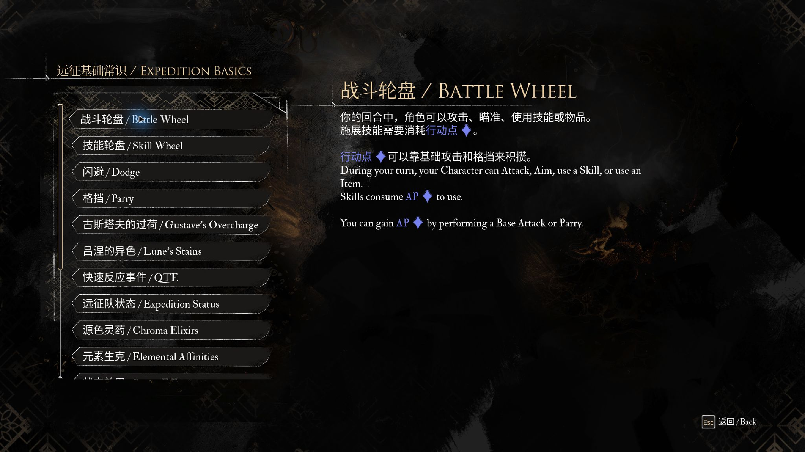
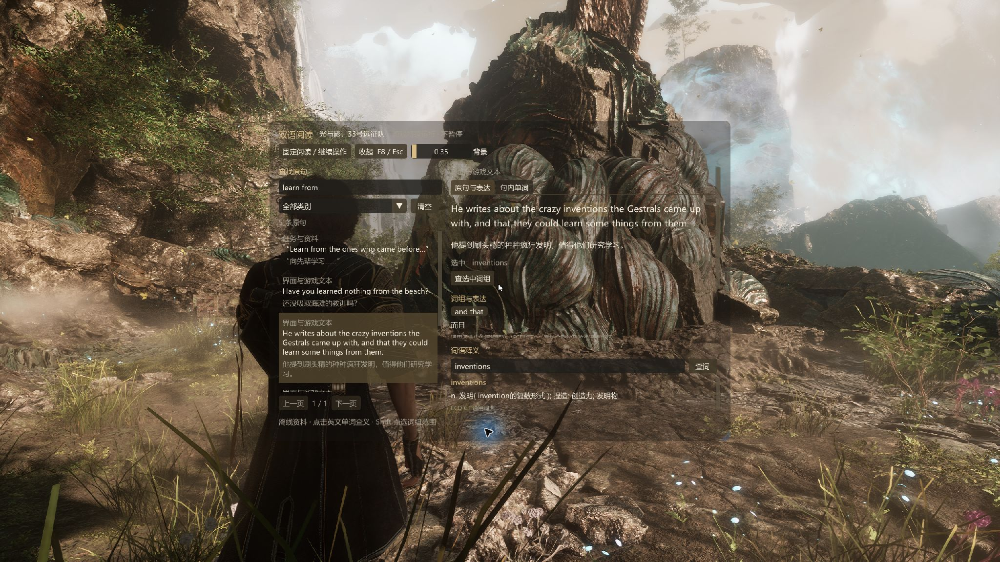
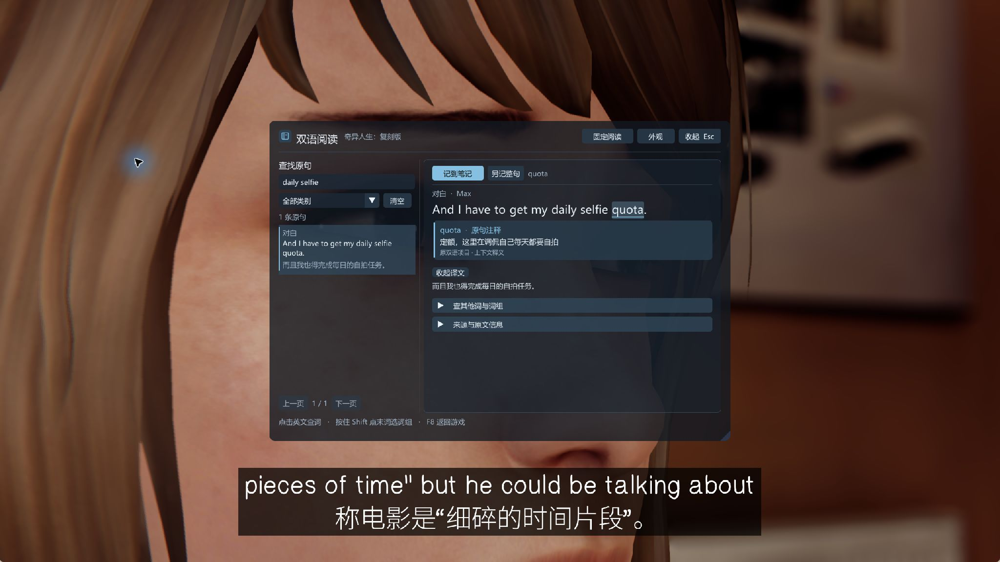
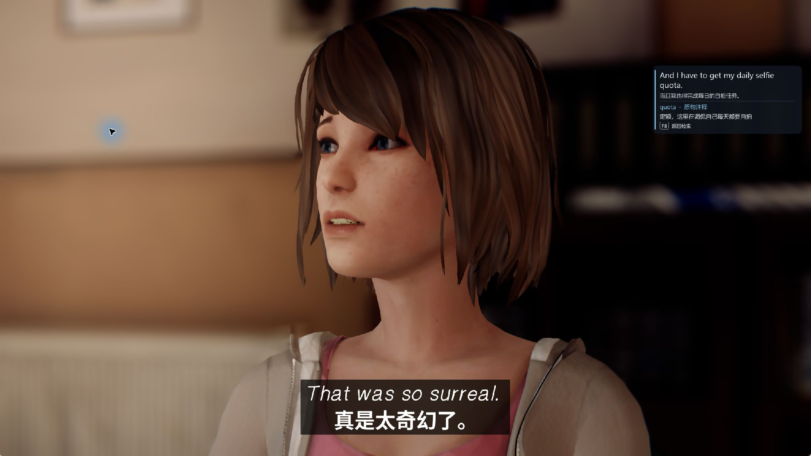

# 双语游戏工作台

在游戏里看中英对照。遇到没读懂的台词或规则，按 **F8** 搜原句，点词看释义，再回到游戏。

**[下载 Windows x64 便携包](https://github.com/iaoq21699-sys/bilingual-game-workbench/releases/download/v0.11.2/BilingualGameWorkbench-0.11.2-Windows-x64.zip)** · Windows 10/11 · [发行页](https://github.com/iaoq21699-sys/bilingual-game-workbench/releases/latest)

> **初期试验阶段** · 适配效果会随游戏版本、语言资源和界面布局变化。遇到问题请多多包涵。欢迎在 [Issues](https://github.com/iaoq21699-sys/bilingual-game-workbench/issues) 留下游戏版本和复现步骤。

## 三步接入自己的游戏

1. **下载并打开。** 完整解压 ZIP，双击 `launch.cmd`。包内自带运行环境。
2. **接入双语。** 点「游戏 → 接入新游戏」，选游戏安装目录，按向导确认中英资源和游戏内显示语言。先用一条菜单或说明验证双语显示。
3. **开启 F8 面板。** 退出游戏后，在工作台选中它，打开「面板设置」。
   - **DirectX 游戏** 首次先运行 `prepare-native-panel.cmd` 获取配套 ReShade，再点「保存并安装」。启动游戏后按 **F8**。
   - **Electron 游戏** 接入语料后点「保存并启用」，再从工作台启动游戏并按 **F8**。

想先试检索，可以从「资料 → 导入文本」导入 [示例语料](examples/bilingual.json)，搜索 `oxygen` 或 `氧气`。仅接入文本时，按 **Ctrl+Shift+B** 呼出桌面检索。具体游戏版本、接入条件和恢复方法见[接入指南](docs/onboarding.md)。

## 实机效果

点击截图可查看大图。

### 《光与影：33号远征队》

**中英同屏**

「远征基础常识」页面的菜单和战斗轮盘说明同时显示中英文。

**按 F8 检索，再点词**

在春意原野按 F8，搜索 `learn from` 就能在左侧找句子，右侧阅读完整中英对照。点原句里的 `inventions`，下方显示词义。

### 《奇异人生：复刻版》

**双语字幕与原句注释**

课堂场景里，底部是游戏的中英字幕。面板中搜索 `daily selfie` 后点 `quota`，会显示句内注释，解释 Max 说「自拍定额」时的调侃。这组实拍沿用了已有双语项目的字幕资料。

查看固定阅读的小卡

固定后，原句和释义留在右上角，游戏继续接收键鼠。按 **F8** 回到检索。

## 制作资料

- [用 GPT 做双语语料、审校和面板布局](docs/gpt-workflow.md)
- [从源码运行、构建插件与打包](docs/build.md)
- [第三方组件来源与许可](docs/THIRD_PARTY.txt)

检索与笔记保存在本机。使用游戏内的「记到笔记」可以收藏词、词组或整句，再到工作台复习。
